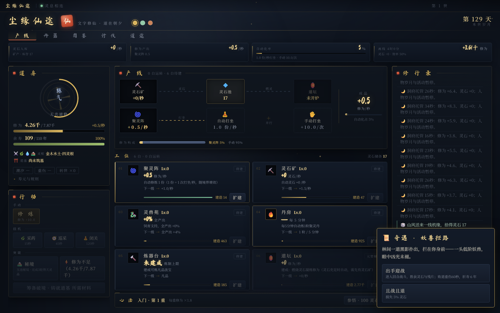

# 尘缘仙途

**文字修仙 + 休闲工厂挂机**的单机游戏。你经营一座洞府：灵石矿供料、聚灵阵自动打坐、道坛把灵石烧成修为，人只要偶尔回来扩建工位、参悟心法、破境转世。



- **不用一直盯着**：自动修炼从开局就运转，随境界放大到每秒数十份打坐；离线 4 小时按 50% 结算灵石与修为。
- **产线视角**：界面主视图是产能走向（灵石矿 → 灵石池 → 道坛、聚灵阵 → 自动打坐），六座建筑就是六台工位，每张卡片直接给出「下一级买到多少产能」。
- **一世约 30 小时**：从练气到大罗，自动化占比由 24% 升到 78%，完全不点击也能证道。
- **服务端权威**：所有资源校验、扣料与随机判定都在 Node 侧完成，前端只做展示，刷新和换设备不会出现两套账。

## 下载试玩（Windows）

到 [Releases](../../releases) 下载 `ChenyuanXiantu-3.0.0-portable.exe`，双击即玩——免安装、不联网、不需要 Node 环境。

存档写在 `%APPDATA%\chenyuan-xiantu\save.json`，删掉这个文件就是重新开局。

## 这是什么

Vue 3 + Express + WebSocket 的文字修仙游戏。服务端持有一个游戏世界，浏览器接收状态并发送行动。多个页面共用同一角色和存档。

## 灵根与破境玩法

- 五行可混合成一至五灵根，共 31 种组合；冰、雷、风各自只能是变异单灵根。不同组合实际影响修炼、寿元、掉落与花费。
- 筑基需对应丹药和适配灵根的同品级主材，共八系各三件宝物。混合根逐系寻物并消耗合灵玉调和；五灵根可改寻三种完整五行宝物。失败保留主材与合灵，成功才消耗。
- 丹器页新增「寻道录」：人道完成地方委托，地道定向勘察后稳取或战斗，天道研读传承并通过本系试炼；冰雷风有独立地点，五灵根有五印八篇的古府专线。线索、成本、进度和下一步操作可直接查看，重启保留剩余计时与现场。
- 人道上限元婴、地道上限渡劫、天道可证道。成功筑基后只能通过转世重修改变上限，触顶时首世也可转世，后续世须本世重新筑基，不能连续空转刷道行。触顶界面引导转世，不再推荐超出上限的丹药。
- 金丹、元婴至最终证道均有专属丹药、功法与悟道条件。采药、历练、秘境与讨伐提供灵材，完整闭关获得心得；丹器页可炼丹、查看来源及购买材料，道途页列出全部晋升条件。
- v9 保留已选道基与库存；旧通用筑基之物当前世仍可使用，旧专属材料一次性折算为寻道经历。v7 之前已筑基的角色延续原上限；旧阴阳、天道灵根当世沿用旧法，转世后执行新匹配规则。

具体数值、失败规则和开源方案评估见 [GAMEPLAY.md](GAMEPLAY.md)。

v10 已接入半自动战斗：固定境界敌人、术法配装、真元与冷却、重招预告暂停、法宝和灵兽行动、分阶丹符及战后调息。点击与自动共用每回合一次行动。战斗、采集、闭关、寻道、参悟与调息互斥；断线后暂停人物活动，只结算符合条件的洞府离线收益。

寿元账本分别记录自然消耗、战败损伤、可修复额度和延寿。回春丹恢复气血，养元丹修复部分战损，延寿丹有本世额度。炼器可选择器型并继承词条，道坛可熄炉留存灵石，修行录从上向下追加。

v11 优化了配置依赖、库存写入、存档快照和连接生命周期。丹药获得时立即记录品阶；v10 及更早存档自动迁移，v11 库存不一致会拒绝读取并尝试备份。带请求编号的操作会收到执行结果，关键操作先保存再确认；无效操作不再触发即时写盘。

本轮（2026-10-16）从五个角度优化可玩性：**决策深度**——奇遇与秘境的风险成功率随道心提升（只增不减），并为两处高风险场景新增「以灵石/灵液护持」的资源投入选项；**早期手感**——修炼加入连击（窗口内累积）与暴击，放宽空格/回车快捷键；**长期成长**——转世新增「跨世传承」三选一（功法 / 洞府 / 悟性，各保留半数）与道行里程碑（每 10 点道行 +1 次开局重抽）；**自动化前置**——自动修炼改为锚定点击值并随境界额外 +15%（点击不享受），聚灵阵 0 级即有基础自动修炼，界面显示自动化占比；**战斗隔离为可选试炼**——寻道录取物阶段补齐「稳妥取物」的挂机时长（人道 45 / 地道 90 / 天道 120 秒），战斗捷径改为更省料、更快并另发试炼之赏（修为、残片、天灵晶，天道另加悟道心得），破境不再要求打赢任何一场战斗。实测（`node test/pace2.mjs`）总时长 28.0h 与改动前 30.3h 基本持平，而自动化占比从练气 24% 递增到大罗 78%，完全不点击也能在 30.5h 内证道；`node test/seek-pace.mjs` 的 72 次首世筑基仍全部通过。新增机制只做叠加，未改动 `layerNeed()` 的数值锚，存档结构仍为 `S.v = 11`。详见 [GAMEPLAY.md](GAMEPLAY.md)。

[半自动战斗与全局成长设计稿](COMBAT_AND_PROGRESSION_DESIGN.md) 的基础循环已经落地；五类战斗目标、完整元素抗性和后期专属准备仍是后续设计，当前行为以 [GAMEPLAY.md](GAMEPLAY.md) 为准。

## 运行

需要 Node.js 20.10 或更新版本。

```powershell
npm install
npm run dev
```

开发地址默认是 `http://127.0.0.1:3000`。生产运行：

```powershell
npm run build
npm start
```

修改服务端代码后需要重启 Node 进程，前端开发更新由 Vite 处理。

## 桌面版（Windows exe）

除浏览器版外，项目可直接运行并打包为 Windows 桌面程序（Electron 外壳）。

```powershell
npm install
npm run desktop     # 构建前端后启动桌面窗口
npm run dist        # 打包免安装 exe，输出到 out/
```

桌面版特性：

- **内置服务**：主进程自动挑选空闲端口并拉起同一套 `server/index.mjs`（生产模式服务 `dist/`），渲染进程仍只连本地 WebSocket —— 玩法、服务端权威判定与浏览器版完全一致，前端代码零分叉。
- **横版窗口**：默认 1440×900，最小 1180×700。顶部产能带 + 三栏工作区，宽屏下自动铺满（超过 1720px 时侧栏同步加宽）。
- **无边框顶栏**：隐藏系统标题栏，顶部为可拖拽的应用条（显示连接状态与本世数），右上角保留系统最小化/最大化/关闭按钮，并随三套主题换色。
- **离线自足**：书法标题字体已随包内置（`public/fonts/`），不再请求外部字体服务，断网也能正常显示。
- **存档位置**：桌面版写入系统用户数据目录（Windows 为 `%APPDATA%\chenyuan-xiantu\save.json`），与浏览器版的 `server/saves/default.json` 互不影响；单实例锁保证不会有两个窗口争抢同一存档。

打包配置见 `package.json` 的 `build` 字段，应用图标由 `build/make-icon.py` 生成。

## 界面结构（产线视图）

游戏按「休闲工厂挂机」组织界面，主视图是产线而不是升级列表：

- **顶部产能带**：灵石入库、修为产出、自动化率、离线 4 小时预估，四个读数贯穿全宽。
- **产线走向**：`灵石矿 → 灵石池 → 道坛` 与 `聚灵阵 → 自动打坐` 两路汇入「成品·修为/秒」，手动打坐以「＋ 并行」标记挂在旁边（它不是自动打坐的下游，别画成箭头）；底部给出聚灵阵 / 道坛 / 手动三段的**修为构成条**。道坛抽灵快于矿产时会直接告警（全产线唯一的真实瓶颈）。
- **六台工位**：聚灵阵、灵石矿、灵兽苑、丹房、炼器台、道坛各一张卡片，显示当前读数、功能说明、**扩建预览**（等级 +1 后的产能）、灵石储备 / 成本的进度条与扩建按钮。
- **心法条**：功法品阶与参悟入口压成一行，常驻中栏底部。
- **左栏**：道身（境界环 + 修为/余寿两条命脉 + 灵根/道基/体质），行动按「手动 / 挂机 / 突破」三组收纳。
- **右栏**：修行录。

所有读数都由 `shared/state.js` 的纯函数复算（新增 `outputMix`、`offlineForecast`），前端不重写任何游戏公式。

> 受限环境（虚拟机 / 容器 / 受管控桌面）中 Chromium 沙箱可能导致 GPU 进程反复崩溃并让应用直接退出。主进程默认关闭沙箱（本应用只加载本地打包内容，不访问外部页面）；如需恢复沙箱，启动前设置环境变量 `XY_ENABLE_SANDBOX=1`。

## 存档

默认文件是 `server/saves/default.json`，每 20 秒保存，关键操作、战斗回合、连接状态变化及正常退出时也会保存。写入失败则暂停推进并提示，定期重试。完整快照包含角色、开局选择、商店购买、战斗、面板和行动剩余秒数；写入采用临时文件替换，并保留 `.bak` 镜像。主档损坏时读取备份，两份都无法读取时停止启动并保留原文件。

旧版只含角色状态的 JSON 会自动迁移。旧档未记录的开局抽选和战斗过程无法还原；有待领取商品时恢复开局商店，寿元已归零时恢复终局。已有道行和成就从修复后的转世开始正确保留，过去已经丢失的数据无法凭空补回。

可通过环境变量选择端口、监听地址和独立存档：

```powershell
$env:PORT = '3001'
$env:SAVE_FILE = 'D:\saves\test-save.json'
npm run dev
```

默认仅监听本机；设置 `HOST` 可改变监听地址。当前没有账户和玩家隔离，所有能连接的客户端都可以操作同一存档。

同一存档只允许一个服务进程使用，即使端口不同也不能同时运行。重复启动会提示先关闭旧服务；正常退出自动释放存档锁，强制结束后重启可能等待约 10 秒回收锁。启动失败不会写回存档。更新服务端代码后，请先用 `Ctrl+C` 退出原服务，再运行启动命令；刷新浏览器不会重载 Node 进程。

## 验证

```powershell
npm test
npm run build
```

测试包括游戏系统断言、固定种子的完整证道模拟、存档恢复，以及使用临时存档和随机端口的真实 WebSocket 集成测试。测试不会操作默认游戏存档。

`test/pace.mjs`、`test/pace2.mjs` 和 `test/seek-pace.mjs` 用于节奏分析。机器人通过真实经营、炼丹、闭关与寻物筹备，没有直接赠送资源。v10 已重新验证 34 种灵根的全部稳取路线、72 次不同灵根与种子的首世筑基，以及完整天道证道流程；样本结果见 GAMEPLAY。本次没有调整修为需求曲线。

## 代码结构

`server/engine.mjs` 负责世界推进、状态帧与存档恢复；`server/systems/` 分离经营、破境、奇遇、战斗、轮回及活动规则。`shared/combat-simulation.js` 是无网络和文件依赖的战斗结算层，`shared/life.js`、`shared/inventory.js` 分别负责寿元账本与分阶库存。Vue 通过共享公式展示信息，资源校验和扣除由服务端完成。

`shared/data.js` 仅持有配置，动态文案位于 `shared/presentation.js`，创建状态与旧档规范化位于 `shared/state-schema.js`。`src/store/connection.js` 管理连接、重试和心跳，Vue store 负责应用快照，页面挂载/卸载显式启停连接。状态帧保留完整日志，不再重复发送 `logDelta`。

本轮边界、兼容策略和开源评估见 [ARCHITECTURE.md](ARCHITECTURE.md)。

历史浏览器版 `old-version/` 和已失效的调试、截图脚本已移出源码目录，保存在 `output/archives/legacy-code-20260916.zip`，恢复方法见 [归档说明](output/archives/README.md)。正式测试与三个节奏分析脚本仍在 `test/`；旧存档迁移及旧战斗恢复继续保留在当前实现中。
